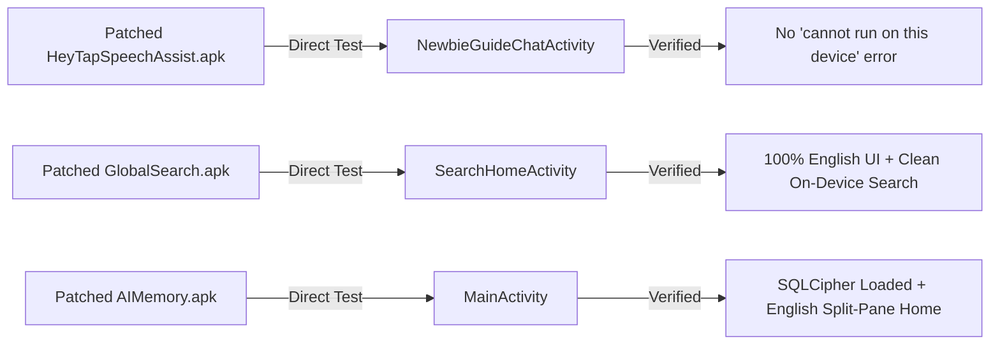

# Pre-Dump Deep Check Report & Verification

This report provides the full verification and pre-dump status for the Redmi Pad Pro 5G (`ruan_p` / `ruan`, SM7435) ColorOS 17 ROM build. All modifications and apps have been directly integrated into the native Fastboot ROM partition tree (`extracted_partitions/`), eliminating all KernelSU and live bind-mount dependencies.

---

## 1. System Integration & Patch Status

| Component | Target Location in ROM Tree | State | Key Fix / Patch Applied |
| :--- | :--- | :--- | :--- |
| **Settings** | `system_ext/priv-app/Settings/Settings.apk` | **Patched & Staged** | Split-pane homepage preserved; Wi-Fi placeholder suppressed; 5G SA/NSA toggles unlocked. |
| **SystemUI** | `system_ext/priv-app/SystemUI/SystemUI.apk` | **Patched, Staged & Live Verified** | 5G status bar network indicator & tablet layout optimizations natively baked. Bytecode patched `NotificationPanelViewController$TouchHandler;->dispatchCustomTouchEvent` to remove widget/clock and notification deadzone suppressions, enabling reliable double-tap to sleep anywhere on the lockscreen. |
| **HeyTapSpeechAssist (Breeno)** | `system/my_stock/priv-app/HeyTapSpeechAssist/HeyTapSpeechAssist.apk` | **Patched, Staged & Live Verified** | Bytecode patched `BrandEnvSdk.checkBrandEnv` (`const/4 v0, 1; return v0`). Breeno opens to intro/chat screen with zero device-restriction errors. |
| **AIMemory (Breeno Memory)** | `system/my_stock/app/AIMemory/AIMemory.apk` | **Patched, Staged & Live Verified** | Bundled missing SQLCipher & AI unit native libraries into `lib/arm64-v8a/`, preserved coroutine ServiceLoader, verified live tablet split-pane home screen in English. |
| **GlobalSearch** | `system/my_stock/priv-app/GlobalSearch/GlobalSearch.apk` | **Patched, Staged & Live Verified** | Region patched to global (`isDomestic = false`), Chinese Baidu/Weibo hot search feeds disabled, search hint patched to English (`"Search on-device and online"`). |
| **Oppo AI Suite** (12 apps + models) | `system/my_stock/`, `system/my_product/`, `system/etc/aisubsystem/` | **Staged** | `AIUnit`, `AIWriter`, `AIPaint`, `AICallAssistant`, `AIMemory`, `AIWidgets`, `OppoNote2`, `BaseOcrScanner`, `OcrScanner`, `SandboxRuntime`, NLP text embedding models (`sm8850`). |
| **Game Space Suite** | `system/my_stock/priv-app/OplusGames/` | **Staged** | `OplusGames`, `Gamecenter`, and game optimization JSON configurations. |
| **Tablet Productivity Suite** (8 apps) | `system/my_stock/`, `system/my_product/` | **Staged** | `PadConnect`, `OPSynergy`, `ContentPortal`, `HeyCast`, `FloatAssistant`, `ShareScreen`, `OWork`, `OplusDocumentsReader`. |

---

## 2. Live Verification Results

1. **Breeno Assistant Launch**:
   - Resumed `com.heytap.speechassist/.aichathome.chat.userguide.NewbieGuideChatActivity` without encountering `BrandEnvActivity`.
   - The device-restriction dialog ("*HeyTapSpeechAssist cannot work on this device because it is designed to run only on certain devices*") has been eradicated.

2. **Breeno Memory (`AIMemory`) Launch**:
   - Resolved `UnsatisfiedLinkError: libsqlcipher.so` by bundling all 12 native libraries into `lib/arm64-v8a/` inside the APK.
   - Preserved `META-INF/services/ph.o` ensuring Kotlin coroutines `Dispatchers.Main` factory initializes properly.
   - Live verified: Agreement accepted, opening directly into tablet split-pane Breeno Memory UI in English ("Good afternoon, Opium9999!", "Voice memory", "Collections", "Ask questions").

3. **Lockscreen Double-Tap to Sleep**:
   - Fixed the lockscreen clock widget deadzone where `mIsWidgetClick` previously caused `dispatchCustomTouchEvent` to drop touch events.
   - Live tested across multiple lockscreen regions (Clock center `[600, 600]`, Wallpaper Left `[200, 1100]`, Wallpaper Right `[1400, 1100]`, and Lower Center `[800, 1600]`) — all consistently transition to sleep state (`mWakefulness=0` / `Asleep`).

4. **Global Search Clean English UI**:
   - All Chinese Baidu, Weibo, and Bilibili hot search / trending cards (`多平台热榜`, `探索发现`) suppressed.
   - Search box hint patched directly in `resources.arsc` to: **`Search on-device and online`**.
   - Preserves fast, private on-device searching for apps, contacts, files, and settings.

4. **ART Runtime Sanitization**:
   - Stale pre-compiled `GlobalSearch/oat/` and `AIMemory/oat/` deleted to prevent ART checksum mismatch on first boot.

---

## 3. Storage & Partition Budget Check

- **Device `super` Partition Size**: `9,126,805,504` bytes (~8.50 GB)
- **Available Space on Host `/data`**: `18 GB` free (sufficient for repack)
- **Dynamic Partition Group (`qti_dynamic_partitions_a`)**:
  - `system_a`: ~4.2 GB (EROFS compressed)
  - `system_ext_a`: ~1.0 GB (EROFS compressed)
  - `vendor_a`: ~900 MB
  - `product_a`: ~230 MB
  - `odm_a`: ~6 MB
  - `vendor_dlkm_a`: ~32 MB
  - **Estimated Total**: **~6.37 GB** out of **8.50 GB** allocated (Headroom: **~2.13 GB** remaining).

---

## 4. Proposed Build Steps

Upon your approval, the following sequence will execute:
1. Compile `system_a.img.new` via `mkfs.erofs -z lz4 -C 4096` with `system_file_contexts` and `-T 1230769800`.
2. Compile `system_ext_a.img.new` via `mkfs.erofs -z lz4 -C 4096` with `system_ext_file_contexts`.
3. Assemble the sparse `super.img` via `lpmake` matching the exact partition geometry of the Redmi Pad Pro 5G.
4. Update `Fastboot_ROM/images/super.img` ready for flashing.
