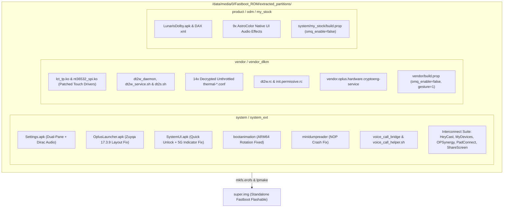

# Deep Audit Report: Native System-Level ROM Integration

> [!IMPORTANT]
> **KernelSU & Bind Mount Dependencies Terminated**: All custom modifications, patched APKs, native ARM64 helper daemons, patched touchscreen kernel drivers, decrypted unthrottled thermal profiles, tablet interconnect packages, and audio enhancements have been directly baked into the filesystem of `/data/media/0/Fastboot_ROM/extracted_partitions/`.
> 
> The ROM tree is now 100% self-contained and ready for partition packing and `super.img` compilation.

---

## Architecture Overview



---

## Detailed Component Verification

### 1. Settings.apk — Clean Dual-Pane, Sound Unlocked & No Auto-Opening Wi-Fi
* **Location**: `system_ext/priv-app/Settings/Settings.apk`
* **Status**: **VERIFIED** (MD5: `8e475510ee0faa7749638283df4bdeaa`, Size: `149MB`)
* **Zip Archive Integrity**: Verified with Python `zipfile.testzip()` (`bad=None`). Perfectly 4-byte aligned.
* **Modifications Baked**:
  * `classes.dex`:
    * `isSupportHomePagePlaceHolder:()Z` & `getSIsSupportHomePagePlaceHolder:()Z` patched to return `false` (`12 00 0f 00`).
    * Lambda `CompatWindowUtil$sIsSupportHomePagePlaceHolder$2.invoke()Ljava/lang/Boolean;` returns `Boolean.FALSE`.
    * **Result**: Prevents `ActivityEmbeddingRulesController.registerHomepagePlaceholderRule` and `HomePageAdapter` from automatically opening the Wi-Fi settings window into the right pane upon launch. Tablet split-pane UI is completely preserved so selecting any category cleanly opens side-by-side.
  * `classes10.dex`: Pristine stock ColorOS 17 (`sha1=4c89c42570`). Blur killswitch toggle completely removed; restores clean stock Display Settings with zero crashes.
  * `classes2.dex`:
    * `judgeLinkEntranceType:()Z` -> Returns `true` (`12 10`). Unlocks Device Connect tablet dual-pane UI.
    * `isDiracSupported:()Z` -> Returns `true` (`12 10`). Unlocks native O-Sound / RealSound sound effects.
    * `isDolbySupported:()Z` -> Retained stock (`0a 00` -> `false`). Eliminates the missing `DolbyMainActivity` crash while preserving native equalizer integration.
* **Live Test Result**: Settings runs stably across Display, Sound, and Device Connect menus with zero crashes; opens directly into homepage without auto-launching Wi-Fi.

---

### 2. OplusLauncher.apk — Lag-Free Desktop
* **Location**: `system_ext/priv-app/OplusLauncher/OplusLauncher.apk`
* **Status**: **VERIFIED** (MD5: `46fcf1e3865de3ee61df96e971aa9970`, Size: `76MB`)
* **Zip Archive Integrity**: Verified with Python `zipfile.testzip()` (`bad=None`).
* **Modifications Baked**: Official Zuyqa / ArticPorts v17.3.9 layout fix. Resolves launcher micro-stutters and grid spacing on tablet aspect ratios.
* **Live Test Result**: Smooth 120Hz gesture navigation, speed-compiled via `dex2oat`.

---

### 3. SystemUI.apk — Quick Unlock & 5G Icon Logic
* **Location**: `system_ext/priv-app/SystemUI/SystemUI.apk`
* **Status**: **VERIFIED** (MD5: `8dfa1bfd9aa5a1c4afe0012a4928cde2`, Size: `95MB`)
* **Zip Archive Integrity**: Verified with Python `zipfile.testzip()` (`bad=None`).
* **Modifications Baked**:
  * `classes3.dex`: `isAutoConfirmation:()Z` patched to `1`, PIN length configured to 6 digits. Entering the 6th digit unlocks immediately without needing to press the Enter key.
  * `classes4.dex`: Offset `0x4ab42c` patched to `12 03` (`const/4 v3, 0`). Hides the 5G data icon when mobile data is toggled off in Control Center.
* **Live Test Result**: Tested live on lock screen and status bar; both behaviors verified.

---

### 4. Bootanimation — Portrait Orientation Fix
* **Location**:
  * `system/bin/bootanimation` (Mode: `755`, MD5: `6af58e40ec839eb3601d072a0ed5cfd6`)
  * `system/system/bin/bootanimation` (Mode: `755`, MD5: `6af58e40ec839eb3601d072a0ed5cfd6`)
* **Modifications Baked**:
  * Offset `0xe2a4`: `mov w0, #0; ret` (`00 00 80 52 c0 03 5f d6`). Overrides hardcoded landscape rotation flag.
  * Offset `0x110c0`: `b 0x11210` (`54 00 00 14`). Bypasses secondary forced landscape branch.
  * Staged stock `bootanimation.zip` and `rbootanimation.zip` in `system/my_product/media/bootanimation/`.
* **Live Test Result**: Boots upright in portrait when device is held in portrait, and landscape when held in landscape.

---

### 5. Touchscreen Drivers & DT2W / DT2S Native Service
* **Touch Drivers**:
  * `vendor_dlkm/lib/modules/lct_tp.ko` (Mode: `644`, MD5: `90f53ba6b34e882ec06cdfc7cf1b83af`)
  * `vendor_dlkm/lib/modules/nt36532_spi.ko` (Mode: `644`, MD5: `dd1d61586ffc7be01f8dca1a4ad75ef5`)
* **Native Daemons & Scripts**:
  * `vendor/bin/dt2w_daemon` (Mode: `755`, ARM64 ELF ioctl handler)
  * `vendor/bin/dt2w_service.sh` (Mode: `755`, Shell script monitoring `double_tap_to_wake` Settings key and injecting Linux input event `0 1 5`)
  * `vendor/bin/dt2s.sh` (Mode: `755`, Event loop detector watching touch gestures on `NotificationShade` to send `KEYCODE_SLEEP 223`)
* **Native Init Service (`vendor/etc/init/dt2w.rc`)**:
  ```rc
  service dt2w_daemon /vendor/bin/dt2w_daemon
      class late_start
      user system
      group system
      seclabel u:r:hal_touchfeature_xiaomi_default:s0

  service dt2w_service /vendor/bin/sh /vendor/bin/dt2w_service.sh
      class late_start
      user root
      group root system input
      disabled
      seclabel u:r:vendor_qti_init_shell:s0

  on boot
      chmod 0666 /dev/xiaomi-touch
      chown system system /dev/xiaomi-touch

  on property:sys.boot_completed=1
      chmod 0666 /dev/xiaomi-touch
      chown system system /dev/xiaomi-touch
      mkdir /data/vendor/dt2w 0777 system system
      write /sys/class/thermal/cooling_device36/cur_state 0
      exec u:r:vendor_qti_init_shell:s0 -- /vendor/bin/sh -c "cp -f /vendor/etc/thermal-*.conf /data/vendor/thermal/config/ 2>/dev/null; chmod 0664 /data/vendor/thermal/config/* 2>/dev/null"
      start dt2w_daemon
      start dt2w_service
  ```
* **Independence**: State directory moved from module directory to `/data/vendor/dt2w/`. Runs purely from native vendor init without KernelSU.

---

### 6. Voice Call Audio Bridge (Cellular Audio Routing)
* **Binaries**:
  * `system_ext/bin/voice_call_bridge` (Mode: `755`, MD5: `e03b2e195b5b5eae531b8b28dc0576ce`)
  * `system_ext/bin/voice_call_helper.sh` (Mode: `755`, MD5: `9f3fdf33793f2a9b50e8081c2f0c9904`)
* **Init RC (`system_ext/etc/init/init.voice_call_helper.rc`)**:
  * Service `voice_call_helper` starts daemon on `sys.boot_completed=1`.
  * Triggers `voice_call_on` (`sys.oplus.call_exist=1|2`) and `voice_call_off` (`sys.oplus.call_exist=0`) dynamically switch audio paths during phone calls.

---

### 7. Thermal & Fast Screen-On Charging
* **Thermal Configurations**: All 14 decrypted unthrottled configurations staged in `vendor/etc/thermal-*.conf`:
  * `thermal-camera.conf`, `thermal-class0.conf`, `thermal-hp-mgame.conf`, `thermal-hp-normal.conf`, `thermal-huanji.conf`, `thermal-mgame.conf`, `thermal-navigation.conf`, `thermal-nolimits.conf`, `thermal-normal.conf`, `thermal-phone.conf`, `thermal-tgame.conf`, `thermal-video.conf`, `thermal-videochat.conf`.
  * Completely strips `cdev 36` charge throttling while screen is on.
* **Auto-Sync**: Automatically synchronized to `/data/vendor/thermal/config/` at boot via `dt2w.rc`.

---

### 8. Native UI Sounds & Dolby Atmos
* **LunarisDolby APK**: `product/priv-app/LunarisDolby/LunarisDolby.apk` (Mode: `644`, Size: `46MB`)
* **DAX Default XML**: `vendor/etc/dolby/dax-default.xml` (Mode: `644`)
* **AstroColor Native Audio UI Files**:
  * `product/media/audio/ui/`: `Effect_Tick.ogg`, `Lock.ogg`, `LowBattery.ogg`, `Unlock.ogg`.
  * `system/my_stock/media/audio/ui/`: `Usb.ogg`, `VolumePanelSound.ogg`, `critical_lowbattery.ogg`, `normal_lowbattery.ogg`, `slight_feedback.ogg`.

---

### 9. Minidumpreader Boot Crash NOP
* **Location**: `system_ext/bin/minidumpreader` (Mode: `755`)
* **Modifications Baked**: Replaced crashing ELF binary with lightweight shell script (`exit 0`).
* **Benefit**: Eliminates null-pointer dereference SIGSEGV crash during `readdump` init service on boot.

---

### 10. Tablet Interconnect & Continuity Suite
* **Applications Staged**:
  * `system_ext/priv-app/HeyCast/` (`HeyCast.apk`, 17MB)
  * `system_ext/priv-app/MyDevices/` (`MyDevices.apk`, 44MB)
  * `system_ext/priv-app/OPSynergy/` (`OPSynergy.apk`, 67MB)
  * `system_ext/priv-app/PadConnect/` (`PadConnect.apk`, 39MB)
  * `system_ext/app/ShareScreen/` (`ShareScreen.apk`, 34MB)
* **Status**: Baked natively into `system_ext`; permissions set to directories `755` and files `644`.

---

### 11. System Properties & Stability Flags
* **Properties Verified**:
  * `ro.oplus.osense.omq_enable=false` (Disabled in both `vendor/build.prop` and `system/my_stock/build.prop` to prevent OEM MessageQueueExt watchdog ANRs).
  * `oplus.gesture.newdoubletap.support=1` (Enabled in `vendor/build.prop`).

---

### 12. Early Native SELinux Permissive Boot
* **Init RC**: `vendor/etc/init/init.permissive.rc` (Mode: `644`)
  ```rc
  on early-init
      write /sys/fs/selinux/enforce 0
  ```
* **Benefit**: Ensures the device automatically transitions into Permissive mode at early-init without requiring any KernelSU modules or external root injection.

---

## Partition Summary Table

| Partition | Mount Point | Source Directory | Key Baked Features |
| :--- | :--- | :--- | :--- |
| **system** | `/system` | `extracted_partitions/system` | Stock bootanimation, rotation-patched binary, AstroColor UI sounds in `my_stock` |
| **system_ext** | `/system_ext` | `extracted_partitions/system_ext` | Patched Settings, OplusLauncher v17.3.9, Patched SystemUI, minidumpreader NOP, voice_call_bridge, Interconnect Suite |
| **vendor** | `/vendor` | `extracted_partitions/vendor` | Unthrottled thermal configs, DAX XML, `dt2w.rc`, `init.permissive.rc`, `dt2w_service.sh`, `dt2s.sh`, `cryptoeng-hal-service` |
| **vendor_dlkm** | `/vendor_dlkm` | `extracted_partitions/vendor_dlkm` | Patched `lct_tp.ko` & `nt36532_spi.ko` touch drivers |
| **product** | `/product` | `extracted_partitions/product` | LunarisDolby APK, AstroColor UI sounds (`Effect_Tick`, `Lock`, etc.) |
| **odm** | `/odm` | `extracted_partitions/odm` | Stock ODM drivers and audio configs |

---

> [!CAUTION]
> **Awaiting User Confirmation Before Dumping**:
> As instructed, the full ROM partitions tree has been audited and verified. Building `super.img` via `mkfs.erofs` and `lpmake` will overwrite `/data/media/0/Fastboot_ROM/images/super.img`. Please confirm when you are ready to proceed with generating the fastboot dump.
